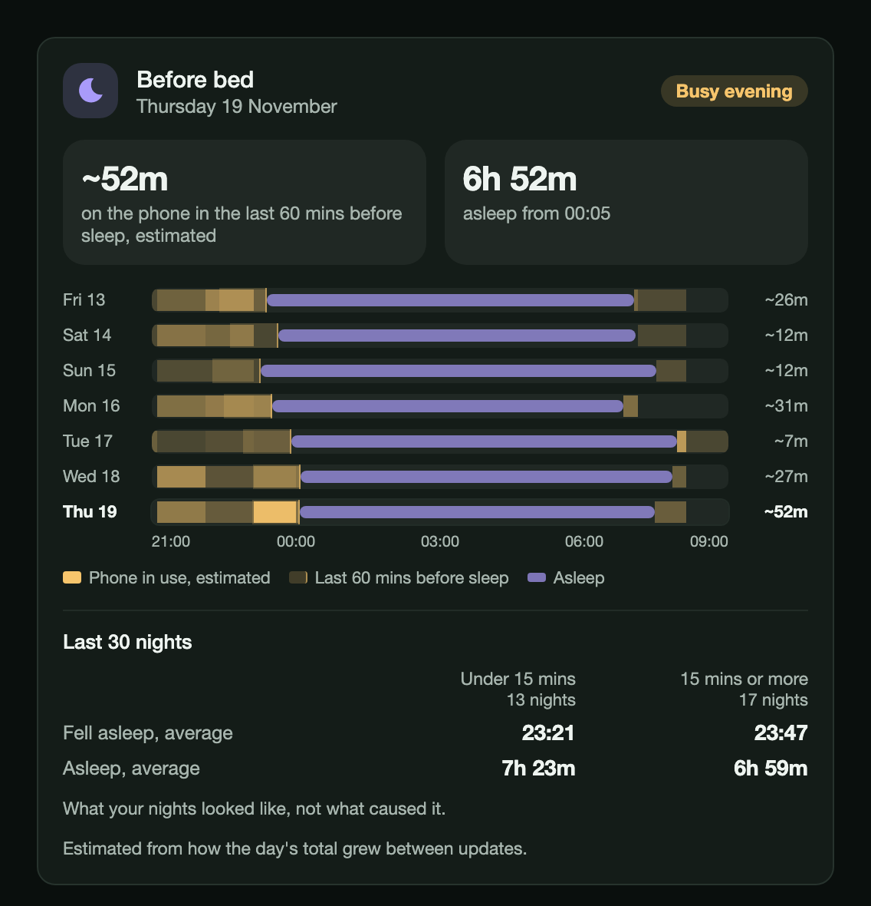

<p align="center">
  
</p>

<h1 align="center">Life Dashboard Before Bed Card</h1>

<p align="center">
  <b>The last hour before sleep on your Home Assistant dashboard.</b><br>
  How long the screen was on before you fell asleep, next to the night that followed, for the last seven nights on one timeline.
</p>

<p align="center">
  <a href="https://my.home-assistant.io/redirect/hacs_repository/?owner=owen282000&repository=life-dashboard-before-bed-card&category=plugin"></a>
  <a href="https://github.com/owen282000/life-dashboard-before-bed-card/releases/latest"></a>
  <a href="https://www.home-assistant.io/"></a>
  <a href="https://github.com/owen282000/life-dashboard-before-bed-card/blob/main/LICENSE"></a>
</p>

<p align="center">
  <a href="https://github.com/owen282000/life-dashboard-before-bed-card#install"><b>Install</b></a>
  &nbsp;·&nbsp;
  <a href="https://github.com/owen282000/life-dashboard-before-bed-card#configure">Configure</a>
  &nbsp;·&nbsp;
  <a href="https://github.com/owen282000/life-dashboard-before-bed-card#works-with-any-sensor">Sensors</a>
  &nbsp;·&nbsp;
  <a href="https://owen282000.com/life-dashboard/">Website</a>
</p>

<!-- life-dashboard:nav -->
<p align="center">
  <sub>Life Dashboard: <a href="https://github.com/owen282000/life-dashboard-companion-app">Android app</a> &nbsp;·&nbsp; <a href="https://github.com/owen282000/life-dashboard-companion-app-ios">iPhone app</a> &nbsp;·&nbsp; <a href="https://github.com/owen282000/life-dashboard-ha">Home Assistant integration</a> &nbsp;·&nbsp; <a href="https://github.com/owen282000/life-dashboard-stack">Grafana stack</a> &nbsp;·&nbsp; <a href="https://github.com/owen282000/life-dashboard-sleep-card">Sleep card</a> &nbsp;·&nbsp; <a href="https://github.com/owen282000/life-dashboard-screen-time-card">Screen time cards</a> &nbsp;·&nbsp; <a href="https://github.com/owen282000/life-dashboard-year-card">Year card</a> &nbsp;·&nbsp; <a href="https://github.com/owen282000/life-dashboard-activity-card">Activity card</a> &nbsp;·&nbsp; <b>Before bed card</b></sub>
</p>
<!-- /life-dashboard:nav -->

<p align="center">
  <picture>
    <source media="(max-width: 600px) and (prefers-color-scheme: light)" srcset="https://raw.githubusercontent.com/owen282000/life-dashboard-before-bed-card/main/docs/readme-hero-phone-light.png">
    <source media="(max-width: 600px)" srcset="https://raw.githubusercontent.com/owen282000/life-dashboard-before-bed-card/main/docs/readme-hero-phone.png">
    <source media="(prefers-color-scheme: light)" srcset="https://raw.githubusercontent.com/owen282000/life-dashboard-before-bed-card/main/docs/readme-hero-light.png">
    
  </picture>
  <br><sub>Sample data from a made-up phone. Each row runs from 21:00 to 09:00 with the screen-on moments, the last hour before sleep shaded and the night as a bar. The table sets 12 calm evenings against 18 others.</sub>
</p>

The card reads two sensors: one that knows when you slept, and one that knows when the screen was on. It shows what your evenings and nights looked like. It doesn't diagnose anything, give advice or score you.

With the [Life Dashboard app](https://github.com/owen282000/life-dashboard-companion-app) and its [integration](https://github.com/owen282000/life-dashboard-ha), one app on your phone brings both: the night from any watch that writes to Health Connect or Apple Health, as the time actually asleep, and your Android phone's screen time next to it.

<a href="https://play.google.com/store/apps/details?id=com.owen282000.lifedashboard&referrer=utm_source%3Dgh-beforebed-readme%26utm_medium%3Dreadme"></a>

The card also works without the app. On Android, Home Assistant's Companion app has both sensors, and [Works with any sensor](#works-with-any-sensor) lists what else you can use.

## What you get

- **The last hour before sleep.** The minutes of screen in the hour before you fell asleep, and how long you slept after it. Make the hour 30 or 90 minutes if that fits you better.
- **Seven nights on one timeline.** A row per night along the evening's clock: when the screen was on, the last hour shaded, and the night as a bar. Tap a night to see its numbers.
- **The last 30 nights, side by side.** Evenings with little screen against the others: how many of each, when you fell asleep on average and how long you slept. It only shows when both groups have five nights, and it never says one caused the other.
- **Honest about what it knows.** A number that is an estimate is marked with `~` and drawn as a shaded band. A night from before the history began shows a dash, not zero.
- **Your locale and theme.** English, Arabic, Chinese, Dutch, French, German, Hindi, Italian, Japanese, Portuguese and Spanish, your time format and time zone, and the colors of your theme in light and dark.

## Install

### What you need

- **Home Assistant 2026.3 or newer.**
- **Two sensors, often from two different apps**: one for the night and one for the screen. [Works with any sensor](#works-with-any-sensor) lists what you can use for each.
- **An Android phone for the screen.** An iPhone can't supply it: iOS has no API that lets an app read screen time. The night can come from an iPhone or from any watch.
- **Both sensors in the recorder.** The card reads their history from your own Home Assistant. The seven nights on the timeline need 8 days of it, which the default of 10 days covers. The table of the last 30 nights needs 31 days, so set [`purge_keep_days`](https://www.home-assistant.io/integrations/recorder/#purge_keep_days) to 31 or more if you want it.

### Through the Home Assistant Marketplace

In **Settings > Marketplace** (HACS before Home Assistant 2026.11), search for **Life Dashboard Before Bed Card** and download it. The button opens it in your Home Assistant straight away:

[](https://my.home-assistant.io/redirect/hacs_repository/?owner=owen282000&repository=life-dashboard-before-bed-card&category=plugin)

If the search finds nothing, your Home Assistant has not refreshed its list yet. Until it does, add the repository yourself: the three dots, **Custom repositories**, and `https://github.com/owen282000/life-dashboard-before-bed-card` as the type **Dashboard**.

On storage mode dashboards the resource is registered for you. If your dashboards are in YAML mode, add it yourself:

```yaml
lovelace:
  resources:
    - url: /hacsfiles/life-dashboard-before-bed-card/life-dashboard-before-bed-card.js
      type: module
```

### By hand

Copy `dist/life-dashboard-before-bed-card.js` into the `www` folder of your Home Assistant configuration and add it as a resource of the type JavaScript module with the URL `/local/life-dashboard-before-bed-card.js`.

### Is it working?

Refresh the browser after downloading, or the dashboard says "Custom element doesn't exist: life-dashboard-before-bed-card". Then [add the card](#configure). You should now see last night at the top, with the minutes of screen before it, and a row for each night your sensors have history for.

If it stays empty, the card says why:

- **Sensor not found**: the entity in the card doesn't exist. The **Interactive** sensor of Home Assistant's Companion app is off until you switch it on under Manage sensors.
- **No nights yet**: the sleep sensor has no night with a start and an end in its history. A sensor you only just added gets its first night after you next sleep.
- **A dash where the minutes should be**: the screen sensor's history doesn't reach back to that night. The rows fill up night by night, so a new sensor needs a week for the whole timeline.

## Configure

Add the card from the card picker, which has a visual editor, or in YAML:

```yaml
type: custom:life-dashboard-before-bed-card
sleep_entity: sensor.your_phone_last_sleep_asleep
screen_entity: binary_sensor.your_phone_interactive
```

| Option | Required | Description |
| --- | --- | --- |
| `type` | yes | `custom:life-dashboard-before-bed-card` |
| `sleep_entity` | yes | A sensor that knows when you slept, see the [sensors for the night](#works-with-any-sensor) |
| `screen_entity` | yes | A sensor that knows when the screen was on, see the [sensors for the screen](#works-with-any-sensor) |
| `wake_entity` | no | The wake-up time, when `sleep_entity` is a timestamp of the bedtime |
| `title` | no | Instead of "Before bed" |
| `window` | no | Minutes before sleep that count, 15 to 180, 60 by default |
| `nights` | no | Nights on the timeline, 3 to 14, 7 by default |
| `threshold` | no | Under this many minutes an evening counts as calm, 15 by default |
| `compare` | no | `false` hides the table of the last 30 nights |
| `start_attribute`, `end_attribute` | no | The names of the attributes with the night's start and end, when they are not `start` and `end` |

Language, time format and time zone follow your Home Assistant profile.

## Works with any sensor

**For the night**, any of these:

- **Life Dashboard**: `sensor.your_phone_last_sleep_asleep`, on Android and iPhone, from any watch or app that writes sleep to Health Connect or Apple Health.
- **Home Assistant's Companion app on Android**: `sensor.your_phone_health_connect_sleep_start` with `sensor.your_phone_health_connect_sleep_end` as the `wake_entity`, or `sensor.your_phone_health_connect_sleep_duration` on 2026.11.1 or newer.
- **A sensor that is on while you sleep**: a bed sensor, Sleep as Android, or an `input_boolean` you switch yourself.
- **A sensor of your own** with the night's start and end as attributes, or two timestamp sensors for the bedtime and the wake-up.

**For the screen**, either of these:

- **A sensor that is on while the screen is on.** On Android that is `binary_sensor.your_phone_interactive` of Home Assistant's Companion app: switch on **Interactive** under Settings, Companion app, Manage sensors. It reports the moment the screen goes on or off, so the card is exact to the minute. This is the best source there is today.
- **A sensor that counts today's screen time**, such as Life Dashboard's `sensor.your_phone_screen_time_today` or `history_stats`. It has no time of day, so the card estimates: the minutes that came in between two updates were used somewhere between them. With a sync every hour that is rough; set the screen time sync in the Life Dashboard app to 15 minutes to make it closer.

A setup with only Home Assistant's Companion app:

```yaml
type: custom:life-dashboard-before-bed-card
sleep_entity: sensor.your_phone_health_connect_sleep_start
wake_entity: sensor.your_phone_health_connect_sleep_end
screen_entity: binary_sensor.your_phone_interactive
```

**An iPhone** has no screen sensor: iOS has no API that lets an app read screen time, so neither Life Dashboard nor Home Assistant's Companion app can offer one. The card needs an Android phone for the screen; the night can come from anywhere.

## Gets more with the Life Dashboard app

The app is on [Google Play](https://play.google.com/store/apps/details?id=com.owen282000.lifedashboard&referrer=utm_source%3Dgh-beforebed-readme%26utm_medium%3Dreadme) as Health Data for Home Assistant, for €4.99 (US$4.99) once. What it adds today:

- **The night from your watch**, on Android and iPhone, with the time actually asleep instead of the time in bed.
- **The estimate without a second app**: if Life Dashboard already sends your screen time, the card works with `screen_time_today` as it is. It finds the phone's sync times and yesterday's total on its own to place the minutes.

<p align="center">
  <picture>
    <source media="(prefers-color-scheme: light)" srcset="https://raw.githubusercontent.com/owen282000/life-dashboard-before-bed-card/main/docs/estimate-light.png">
    
  </picture>
  <br><sub>Sample data, estimated from a day total that syncs once an hour. The footer of the card says the numbers are estimated.</sub>
</p>

Other ways to install: the same app is free as an APK [on GitHub](https://github.com/owen282000/life-dashboard-companion-app#install) and on [F-Droid](https://f-droid.org/packages/com.owen282000.lifedashboard/).

What comes with a next version of the app and the integration:

- **Which apps in that last hour.** The Android app already reads when each app was in front, but sends only the day's total. A coming version sends the use per quarter of an hour and per app, and the card then shows the apps of the last hour and drops the `~`. The card reads that shape already, so it will be a matter of picking the new sensor. [The design](https://github.com/owen282000/life-dashboard-before-bed-card/blob/main/docs/design.md) has the details. Until that version is out, use the interactive sensor for exact minutes.

## Colors

The colors are CSS variables, so a theme can set them.

| Variable | Default |
| --- | --- |
| `--life-dashboard-before-bed-screen` | `#a86a00`, `#f7c56c` on a dark theme |
| `--life-dashboard-before-bed-sleep` | `#5b4bc4`, `#a99bfa` on a dark theme |
| `--life-dashboard-before-bed-calm` | the theme's `--success-color` |

## Part of Life Dashboard

This card sits on top of Life Dashboard's other parts, and you only install the ones you need. More at [owen282000.com/life-dashboard](https://owen282000.com/life-dashboard/).

<p align="center">
  <b>Start here: the app on your phone</b><br>
  <a href="https://github.com/owen282000/life-dashboard-companion-app"><picture><source media="(prefers-color-scheme: light)" srcset="https://raw.githubusercontent.com/owen282000/life-dashboard-before-bed-card/main/docs/family/android-light.png"></picture></a>
  <a href="https://github.com/owen282000/life-dashboard-companion-app-ios"><picture><source media="(prefers-color-scheme: light)" srcset="https://raw.githubusercontent.com/owen282000/life-dashboard-before-bed-card/main/docs/family/ios-light.png"></picture></a>
</p>

<p align="center">
  <picture><source media="(prefers-color-scheme: light)" srcset="https://raw.githubusercontent.com/owen282000/life-dashboard-before-bed-card/main/docs/family/arrow-light.png"></picture><br>
  <sub>sends your data to</sub>
</p>

<p align="center">
  <b>Where the data goes</b><br>
  <a href="https://github.com/owen282000/life-dashboard-stack"><picture><source media="(prefers-color-scheme: light)" srcset="https://raw.githubusercontent.com/owen282000/life-dashboard-before-bed-card/main/docs/family/stack-light.png"></picture></a>
  <a href="https://github.com/owen282000/life-dashboard-ha"><picture><source media="(prefers-color-scheme: light)" srcset="https://raw.githubusercontent.com/owen282000/life-dashboard-before-bed-card/main/docs/family/ha-light.png"></picture></a>
  <a href="https://owen282000.com/life-dashboard/health-connect-webhook/"><picture><source media="(prefers-color-scheme: light)" srcset="https://raw.githubusercontent.com/owen282000/life-dashboard-before-bed-card/main/docs/family/own-server-light.png"></picture></a>
</p>

<p align="center">
  <picture><source media="(prefers-color-scheme: light)" srcset="https://raw.githubusercontent.com/owen282000/life-dashboard-before-bed-card/main/docs/family/arrow-light.png"></picture>
</p>

<p align="center">
  <b>Cards for your Home Assistant dashboard</b><br>
  <sub>They need Home Assistant; most work with any sensor, and the integration fills them with your history.</sub><br>
  <a href="https://github.com/owen282000/life-dashboard-sleep-card"><picture><source media="(prefers-color-scheme: light)" srcset="https://raw.githubusercontent.com/owen282000/life-dashboard-before-bed-card/main/docs/family/sleep-card-light.png"></picture></a>
  <a href="https://github.com/owen282000/life-dashboard-screen-time-card"><picture><source media="(prefers-color-scheme: light)" srcset="https://raw.githubusercontent.com/owen282000/life-dashboard-before-bed-card/main/docs/family/screen-time-card-light.png"></picture></a>
  <a href="https://github.com/owen282000/life-dashboard-year-card"><picture><source media="(prefers-color-scheme: light)" srcset="https://raw.githubusercontent.com/owen282000/life-dashboard-before-bed-card/main/docs/family/year-card-light.png"></picture></a>
  <a href="https://github.com/owen282000/life-dashboard-activity-card"><picture><source media="(prefers-color-scheme: light)" srcset="https://raw.githubusercontent.com/owen282000/life-dashboard-before-bed-card/main/docs/family/activity-card-light.png"></picture></a>
  <picture><source media="(prefers-color-scheme: light)" srcset="https://raw.githubusercontent.com/owen282000/life-dashboard-before-bed-card/main/docs/family/before-bed-card-here-light.png"></picture>
</p>

## Privacy

The card reads the sensors you chose and asks your own Home Assistant for their history. It makes no other requests, has no telemetry or analytics, and there's no server of mine in the path.

<!-- life-dashboard:built -->
## How this is built

Life Dashboard is a one-person project, and [Claude Code](https://claude.com/claude-code) writes a large part of the code. I decide what gets built, read every change before it is merged, and test it on my own phones and Home Assistant before a release. Automated checks run on every pull request, and the [AI policy](https://github.com/owen282000/life-dashboard-companion-app/blob/main/AI_POLICY.md) explains what the AI does and what I check.
<!-- /life-dashboard:built -->

## Documentation

- [Changelog](https://github.com/owen282000/life-dashboard-before-bed-card/blob/main/CHANGELOG.md)
- [Where the numbers come from](https://github.com/owen282000/life-dashboard-before-bed-card/blob/main/docs/design.md), with how the estimate works
- [The Health dashboard](https://github.com/owen282000/life-dashboard-ha/blob/main/docs/dashboard.md) of the integration, to put this card on

## Help and contributing

Bugs go to [issues](https://github.com/owen282000/life-dashboard-before-bed-card/issues) here. Questions go to the integration's [Discussions](https://github.com/owen282000/life-dashboard-ha/discussions). No GitHub account? Use the [feedback board](https://owen282000.com/life-dashboard/feedback/), which needs no account. Everything on it is public, so leave out health data, logs and webhook URLs.

Pull requests are welcome, see [CONTRIBUTING](https://github.com/owen282000/life-dashboard-before-bed-card/blob/main/CONTRIBUTING.md). The card is one JavaScript file with no dependencies and no build step. Security problems go through a [private advisory](https://github.com/owen282000/life-dashboard-before-bed-card/security/advisories/new).

## Support the project

Stars, shares and good bug reports all help. If you want to chip in for the evenings that go into it, there's [Ko-fi](https://ko-fi.com/owen282000). The card stays free and open source (MIT) either way.

MIT licensed. See [LICENSE](https://github.com/owen282000/life-dashboard-before-bed-card/blob/main/LICENSE).

<!-- life-dashboard:footer -->
<p align="center">
  <sub>Made by <a href="https://github.com/owen282000">Owen Vogelaar</a> for the self-hosting and quantified self crowd.</sub><br>
  <sub>Google Play and the Google Play logo are trademarks of Google LLC.</sub><br>
  <sub>Apple, the Apple logo and App Store are trademarks of Apple Inc.</sub>
</p>
<!-- /life-dashboard:footer -->
